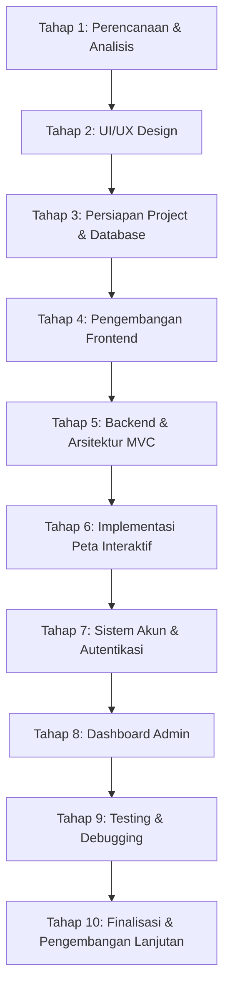

# 🗺️ Roadmap Pengerjaan Project FaunaID

> **FaunaID** adalah platform web edukasi dan eksplorasi keanekaragaman fauna Indonesia yang dilengkapi dengan katalog fauna, artikel edukatif, sistem akun pengguna & favorit, dashboard manajemen admin, serta peta persebaran fauna interaktif berdasarkan tiga zona biogeografi Indonesia (Asiatis, Peralihan, dan Australis).

---

## 📌 Ringkasan Roadmap

Roadmap ini merupakan tahapan pengembangan website **FaunaID** dari awal perencanaan hingga siap digunakan dan dideploy. Pengerjaan dilakukan secara bertahap dan terstruktur agar setiap fitur dapat dikembangkan, divalidasi, serta diuji sebelum melanjutkan ke tahap berikutnya.



---

## 🛠️ Tech Stack & Lingkungan Pengembangan

| Komponen | Teknologi / Tools | Keterangan |
| :--- | :--- | :--- |
| **Local Environment** | Laragon (Apache, MySQL, PHP) | Manajemen local server & database |
| **Database** | MySQL via phpMyAdmin | Penyimpanan data relasional |
| **Backend** | PHP Native (MVC Pattern) | Arsitektur Model-View-Controller tanpa framework |
| **Database Driver** | PDO (PHP Data Objects) | Koneksi aman menggunakan prepared statements |
| **Frontend** | HTML5, CSS3, JavaScript (ES6+) | Struktur semantik, styling modern & interaktivitas |
| **Peta Interaktif** | SVG / GeoJSON + JavaScript | Peta 3 zona persebaran biogeografi Indonesia |
| **Autentikasi** | PHP Session & Password Hashing | Pengelolaan sesi login aman & RBAC |

---

## 📋 Rincian Tahapan Pengerjaan

### Tahap 1 — Perencanaan dan Analisis
Fokus pada perumusan ide, konsep platform, arsitektur data, dan arah visual proyek.
- [x] Menentukan konsep dan tujuan website FaunaID.
- [x] Menentukan target pengguna (pelajar, mahasiswa, peneliti, pemerhati satwa, dan masyarakat umum).
- [x] Menentukan fitur utama website (katalog fauna, peta interaktif, artikel edukasi, sistem favorit, dashboard admin).
- [x] Membuat alur penggunaan website (*user flow*) untuk pengunjung biasa, pengguna terdaftar, dan admin.
- [x] Membuat rancangan database (Entity Relationship Diagram / ERD) dan relasi antar tabel.
- [x] Menentukan desain dan identitas visual website (moodboard, palet warna bertema alam/hutan Indonesia, tipografi).

**Deliverables:** Dokumen spesifikasi kebutuhan, diagram ERD, dan diagram User Flow.

---
### Tahap 2 — UI/UX Design

---

### Tahap 3 — Persiapan Project dan Database
Fokus pada inisialisasi lingkungan lokal, struktur folder proyek, dan skema database MySQL.
- [ ] Menyiapkan lingkungan pengembangan menggunakan Laragon.
- [ ] Membuat folder project `FaunaID` dengan hierarki direktori awal.
- [ ] Membuat database MySQL baru melalui phpMyAdmin.
- [ ] Merancang dan mengeksekusi tabel database utama:
  - [ ] `users` (id, nama, email, password, role, foto_profil, created_at)
  - [ ] `categories` (id, nama_kategori, deskripsi, slug)
  - [ ] `habitats` (id, nama_habitat, deskripsi)
  - [ ] `regions` (id, nama_wilayah, zona [Asiatis/Peralihan/Australis], deskripsi)
  - [ ] `fauna` (id, nama_lokal, nama_ilmiah, kategori_id, habitat_id, status_konservasi, deskripsi, created_at)
  - [ ] `fauna_images` (id, fauna_id, image_url, is_primary)
  - [ ] `fauna_regions` (id, fauna_id, region_id — relasi many-to-many fauna & wilayah)
  - [ ] `favorites` (id, user_id, fauna_id, created_at)
  - [ ] `articles` (id, user_id, judul, slug, konten, thumbnail, status, created_at)
- [ ] Menentukan relasi antar tabel menggunakan *Foreign Keys* dan aturan *CASCADE/SET NULL*.
- [ ] Mengisi database dengan beberapa data awal (*seed/dummy data*) fauna sebagai bahan uji coba.

**Deliverables:** Skema database (`database.sql`) yang terhubung di phpMyAdmin dan folder proyek siap dikembangkan.

---

### Tahap 4 — Pengembangan Frontend
Fokus pada penerjemahan desain UI menjadi kode antarmuka yang bersih, responsif, dan interaktif.
- [ ] Membuat struktur HTML semantik untuk setiap halaman.
- [ ] Mengimplementasikan styling menggunakan CSS murni (layout Flexbox & Grid).
- [ ] Membuat komponen global yang konsisten: navbar responsif, footer informatif, dan breadcrumb.
- [ ] Membuat komponen katalog fauna dalam bentuk *card* yang rapi dan memuat ringkasan informasi.
- [ ] Membuat halaman detail fauna lengkap dengan informasi spesifikasi dan galeri foto.
- [ ] Membuat tampilan halaman artikel edukasi (daftar artikel dan halaman baca artikel).
- [ ] Mengoptimalkan tampilan responsif untuk berbagai resolusi layar (desktop, tablet, dan smartphone).

**Deliverables:** Halaman antarmuka frontend responsif yang siap dihubungkan dengan engine backend PHP.

---

### Tahap 5 — Pengembangan Backend dan MVC
Fokus pada pembangunan fondasi backend yang terstruktur dan aman menggunakan pola MVC PHP native.
- [ ] Membuat struktur arsitektur MVC (Model-View-Controller) murni:
  - `app/controllers/` (menangani logika permintaan pengguna)
  - `app/models/` (menangani komunikasi dan query database)
  - `app/views/` (menangani template tampilan antarmuka)
  - `app/core/` atau `config/` (koneksi database, routing dasar, helper)
  - `public/` (titik masuk utama `index.php`, asset css, js, images)
- [ ] Membuat konfigurasi koneksi database menggunakan PDO dengan pengaturan *error mode exception* dan *prepared statements*.
- [ ] Membuat Model untuk mengelola data (`FaunaModel`, `CategoryModel`, `HabitatModel`, `ArticleModel`, dll.).
- [ ] Membuat Controller untuk memproses *request* pengguna dan mengarahkan data ke *View*.
- [ ] Menghubungkan data MySQL dengan antarmuka dinamis halaman website.
- [ ] Mengimplementasikan fitur CRUD (*Create, Read, Update, Delete*) untuk entitas data fauna, kategori, habitat, dan artikel.

**Deliverables:** Sistem backend MVC modular yang berhasil memproses data secara dinamis dari database.

---

### Tahap 6 — Implementasi Peta Interaktif
Fokus pada visualisasi geografis keanekaragaman satwa Indonesia berbasis zona biogeografi.
- [ ] Menyiapkan aset peta wilayah Indonesia dalam format vektor SVG atau data koordinat GeoJSON.
- [ ] Membagi peta ke dalam 3 zona persebaran fauna Indonesia:
  - **Zona Asiatis / Sunda Shelf / Barat**: Sumatra, Jawa, Bali, Kalimantan (dibatasi Garis Wallace).
  - **Zona Peralihan / Wallacea**: Sulawesi, Kepulauan Nusa Tenggara, Maluku (di antara Garis Wallace & Weber/Lydekker).
  - **Zona Australis / Sahul Shelf / Timur**: Papua dan pulau-pulau sekitarnya.
- [ ] Memberikan pewarnaan visual yang berbeda dan kontras pada setiap zona wilayah.
- [ ] Membuat interaksi klik dan hover pada setiap wilayah menggunakan JavaScript.
- [ ] Menampilkan panel informasi/modal interaktif ketika suatu wilayah dipilih.
- [ ] Mengambil (*fetch/AJAX*) dan menampilkan daftar fauna khas wilayah terkait langsung dari database.
- [ ] Menghubungkan setiap kartu fauna pada daftar wilayah ke halaman detail hewan yang bersangkutan.

**Deliverables:** Modul peta interaktif edukatif yang menampilkan persebaran fauna Indonesia secara visual dan dinamis.

---

### Tahap 7 — Sistem Akun Pengguna
Fokus pada manajemen otentikasi, hak akses, dan personalisasi pengguna.
- [ ] Membuat halaman formulir registrasi dan login dengan validasi input.
- [ ] Membangun sistem autentikasi pengguna menggunakan `PHP Session` dan hashing password aman (`password_hash()`, `password_verify()`).
- [ ] Menerapkan pembagian hak akses (*Role-Based Access Control* / RBAC) antara pengguna umum (`user`) dan administrator (`admin`).
- [ ] Membuat fitur pengelolaan profil pengguna (ubah nama, email, avatar, dan pembaruan password).
- [ ] Membuat fitur simpan/favoritkan fauna (*Add to / Remove from Favorites*).
- [ ] Membuat halaman daftar fauna favorit khusus bagi pengguna yang sedang login.

**Deliverables:** Sistem autentikasi pengguna yang aman dan fitur bookmark fauna favorit yang berfungsi dengan baik.

---

### Tahap 8 — Dashboard Admin
Fokus pada perancangan antarmuka manajemen konten (*content management system*) khusus administrator.
- [ ] Membuat layout halaman dashboard admin yang profesional (sidebar navigasi, topbar profil, indikator status).
- [ ] Menampilkan ringkasan statistik (jumlah total fauna, kategori, tipe habitat, artikel, dan pengguna terdaftar).
- [ ] Membuat fitur manajemen data fauna lengkap (tambah data baru, perbarui info, hapus data, preview).
- [ ] Membuat fitur pengelolaan data master kategori dan habitat.
- [ ] Membuat fitur pengelolaan data wilayah persebaran fauna.
- [ ] Mengembangkan modul upload dan manajemen media (validasi MIME type, ukuran file maksimal, direktori upload aman).
- [ ] Membuat modul pengelolaan artikel edukasi (tulis artikel, edit konten, kelola status publikasi).
- [ ] Menerapkan proteksi keamanan akses (memastikan hanya akun dengan hak akses admin yang dapat masuk ke dashboard).

**Deliverables:** Dashboard admin yang fungsional, aman, dan mudah digunakan untuk mengelola seluruh data website.

---

### Tahap 9 — Testing dan Debugging
Fokus pada pengujian menyeluruh guna memastikan keandalan, akurasi, dan keamanan sistem.
- [ ] Menguji seluruh alur navigasi dan tampilan halaman website dari awal hingga akhir.
- [ ] Menguji keakuratan fungsi pencarian (*search keyword*) dan filter multi-kondisi.
- [ ] Menguji responsivitas dan interaksi klik pada peta interaktif.
- [ ] Menguji alur sistem registrasi, login, logout, dan manajemen sesi.
- [ ] Menguji fitur tambah dan hapus favorit pada akun pengguna.
- [ ] Menguji seluruh fungsi CRUD serta proses upload file pada dashboard admin.
- [ ] Memperbaiki *bug*, *broken links*, dan galat kode (*error handling*).
- [ ] Menguji kompatibilitas tampilan pada beragam perangkat dan ukuran layar (Mobile, Tablet, Laptop, Desktop).
- [ ] Memeriksa keamanan dari kerentanan umum web: SQL Injection (Prepared Statements PDO), XSS (`htmlspecialchars`), dan verifikasi validitas input.

**Deliverables:** Lembar evaluasi testing (*QA checklist*), perbaikan bug tuntas, serta sistem yang stabil dan aman.

---

### Tahap 10 — Finalisasi dan Pengembangan Lanjutan
Fokus pada optimasi akhir, penyempurnaan konten, pembuatan dokumentasi, dan proyeksi masa depan.
- [ ] Melakukan optimasi performa website (kompresi aset gambar, caching, dan pembersihan kode).
- [ ] Melengkapi basis data dengan informasi ilmiah yang valid dan foto fauna Indonesia berkualitas tinggi.
- [ ] Memastikan seluruh fitur utama berjalan prima sesuai rancangan awal.
- [ ] Menyusun dokumentasi teknis project (panduan instalasi Laragon, struktur folder, skema database).
- [ ] Menyiapkan website untuk demonstrasi presentasi atau proses deployment ke server hosting.
- [ ] Merencanakan pengembangan fitur lanjutan (*Next Phase / Future Development*):
  - [ ] Fitur kuis edukasi fauna interaktif untuk menguji wawasan pengguna.
  - [ ] Sistem poin/skor dan lencana pencapaian (*gamification*) bagi pengguna aktif.
  - [ ] Audio/rekaman suara asli satwa Indonesia.
  - [ ] Fitur kolom diskusi atau komentar moderasi pada halaman detail fauna dan artikel.

**Deliverables:** Website FaunaID versi 1.0 yang siap digunakan, dokumentasi lengkap, dan roadmap pengembangan lanjutan.

---

## 🗄️ Relasi Skema Database (Ringkasan)

```
[ users ]
   ├── id (PK)
   ├── nama
   ├── email
   ├── password
   └── role ('admin', 'user')
        │
        ├──< [ favorites ] >──┐
        │       ├── id (PK)   │
        │       ├── user_id   │
        │       └── fauna_id  │
        │                     │
[ articles ]                  │
   ├── id (PK)                │
   ├── user_id (FK)           │
   ├── judul                  │
   └── konten                 │
                              ▼
                         [ fauna ]
                            ├── id (PK)
                            ├── nama_lokal
                            ├── nama_ilmiah
                            ├── kategori_id (FK) >── [ categories ]
                            ├── habitat_id (FK)  >── [ habitats ]
                            │
                            ├──< [ fauna_images ] (galeri foto)
                            │       └── fauna_id (FK)
                            │
                            └──< [ fauna_regions ] >── [ regions ] (zona persebaran)
```

---

## 💡 Panduan Eksekusi Tim
1. **Pengerjaan Berurutan**: Selesaikan setiap *checklist* pada suatu tahap sebelum berpindah ke tahap berikutnya.
2. **Version Control**: Lakukan *commit* Git secara teratur dengan pesan yang deskriptif pada setiap penambahan sub-fitur.
3. **Backup Rutin**: Selalu lakukan ekspor berkala database MySQL melalui phpMyAdmin selama tahap pengembangan dan pengujian.

