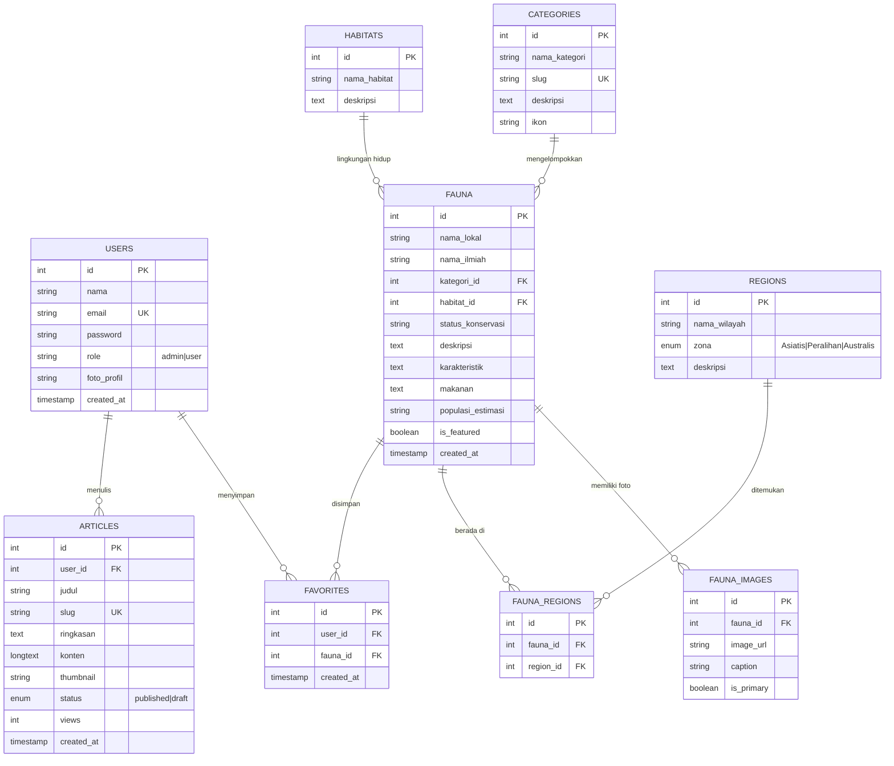

# 📖 Dokumen Analisis dan Perancangan Sistem — FaunaID

> **FaunaID** — Platform Edukasi & Ensiklopedia Digital Keanekaragaman Satwa Nusantara  
> Disusun berdasarkan konsep *Modern Nature Editorial* dengan arsitektur **PHP Native Model-View-Controller (MVC)** dan basis data **MySQL**.

---

## 1. Pendahuluan

### 1.1 Latar Belakang
Indonesia merupakan salah satu negara megabiodiversitas terbesar di dunia dengan kekayaan fauna endemik yang membentang dari Garis Wallace hingga Garis Lydekker. Namun, informasi komprehensif mengenai satwa liar, zonasi persebaran (Asiatis, Peralihan, Australis), serta status keterancaman punah menurut IUCN masih terpencar dan minim visualisasi interaktif bagi pelajar dan masyarakat umum.

### 1.2 Tujuan Sistem
- Menyediakan katalog fauna Indonesia yang terstruktur, lengkap dengan nama ilmiah, taksonomi, habitat, karakteristik, dan status konservasi.
- Menyajikan peta visualisasi interaktif 3 zona biogeografi Indonesia (Asiatis, Peralihan, dan Australis).
- Menyediakan artikel edukatif seputar pelestarian, ekosistem, dan keanekaragaman hayati.
- Menyediakan fitur personalisasi (bookmark fauna favorit pengguna terdaftar).
- Memberikan dashboard Content Management System (CMS) bagi administrator untuk mengelola seluruh data secara terintegrasi (CRUD).

---

## 2. Analisis Kebutuhan Sistem

### 2.1 Kebutuhan Fungsional (Functional Requirements)
1. **Katalog & Detail Fauna**:
   - Pengunjung dapat menelusuri daftar fauna dengan pencarian kata kunci (*live search*).
   - Filter multikriteria berdasarkan Kategori (Mamalia, Burung, Reptil, dll.), Habitat (Hutan Hujan, Sabana, dll.), dan Status Konservasi IUCN.
   - Halaman detail fauna memuat galeri foto, nama ilmiah, taksonomi, karakteristik, makanan, peta wilayah persebaran, dan estimasi populasi.
2. **Peta Interaktif Persebaran Wilayah**:
   - Visualisasi peta vektor kepulauan Indonesia yang dibagi menjadi 3 zona biogeografi.
   - Interaksi klik/hover pada zona (Asiatis, Peralihan, Australis) memfilter dan memunculkan fauna khas zona terkait secara dinamis.
3. **Artikel Edukasi**:
   - Daftar artikel bertema konservasi satwa dengan fitur pencarian dan pembaca artikel lengkap.
4. **Sistem Autentikasi & Akun Pengguna**:
   - Registrasi pengguna baru dan login dengan password terenkripsi (`bcrypt`).
   - Manajemen profil (perubahan nama, foto profil, dan kata sandi).
   - Fitur bookmark / favorit fauna (*Add/Remove Favorite*) berbasis sesi dan database.
5. **Dashboard Manajemen Admin**:
   - Ringkasan statistik (jumlah fauna, kategori, habitat, artikel, pengguna).
   - CRUD data Fauna lengkap beserta upload media gambar dan pemetaan zona wilayah.
   - CRUD data Kategori dan Habitat.
   - CRUD Artikel Edukasi dengan manajemen status penerbitan (*Published / Draft*).
   - Manajemen Pengguna dan kontrol hak akses (*Role-Based Access Control*).

### 2.2 Kebutuhan Non-Fungsional (Non-Functional Requirements)
- **Keamanan**: Penggunaan Prepared Statements PDO untuk mencegah SQL Injection, fungsi `htmlspecialchars` untuk mencegah Cross-Site Scripting (XSS), enkripsi kata sandi `PASSWORD_BCRYPT`, dan proteksi sesi.
- **Responsivitas**: Desain antarmuka mobile-first responsif di desktop, tablet, dan ponsel pintar.
- **Performa**: Waktu muat cepat tanpa beban framework eksternal yang berat (*vanilla lightweight code*).
- **Kompatibilitas**: Berjalan optimal di server lokal (Laragon, XAMPP) maupun web hosting Apache/Nginx dengan PHP 7.4 - 8.x+.

---

## 3. Arsitektur Sistem (Model-View-Controller)

Sistem dibangun menggunakan pola arsitektur **MVC murni (Native)**:

```
FaunaID/
├── app/
│   ├── config/              # Konfigurasi aplikasi & database
│   │   ├── Config.php
│   │   └── Database.php
│   ├── core/                # Core engine MVC
│   │   ├── App.php          # Router & URL Dispatcher
│   │   ├── Controller.php   # Base Controller
│   │   ├── Model.php        # Base Model
│   │   └── Helper.php       # Utility functions & sanitize
│   ├── controllers/         # Logika penanganan request
│   │   ├── HomeController.php
│   │   ├── FaunaController.php
│   │   ├── MapController.php
│   │   ├── ArticleController.php
│   │   ├── AuthController.php
│   │   ├── UserController.php
│   │   ├── AdminController.php
│   │   └── ApiController.php
│   ├── models/              # Logika data & query PDO
│   │   ├── UserModel.php
│   │   ├── FaunaModel.php
│   │   ├── CategoryModel.php
│   │   ├── HabitatModel.php
│   │   ├── RegionModel.php
│   │   ├── ArticleModel.php
│   │   └── FavoriteModel.php
│   └── views/               # Antarmuka tampilan (HTML/PHP)
│       ├── layouts/         # Komponen global (Navbar, Header, Footer)
│       ├── home/
│       ├── catalog/
│       ├── map/
│       ├── articles/
│       ├── auth/
│       ├── user/
│       └── admin/
├── database/                # Skema dan seeder MySQL
│   ├── schema.sql
│   └── seed.php
├── docs/                    # Dokumentasi teknis sistem
│   └── ANALISIS_DAN_PERANCANGAN.md
├── public/                  # Titik masuk publik (Document Root)
│   ├── index.php            # Bootstrap utama
│   ├── .htaccess            # URL Rewriting
│   ├── assets/
│   │   ├── css/
│   │   ├── js/
│   │   └── images/
│   └── uploads/             # Direktori file yang diunggah
├── index.php                # Redirection entry point root
├── planning.md
└── ROADMAP.md
```

---

## 4. Perancangan Basis Data (Database Design)

### 4.1 Diagram Hubungan Entitas (ERD)



---

## 5. Perancangan Antarmuka & Identitas Visual

- **Palet Warna "Modern Nature Editorial"**:
  - `Forest Green` (`#173F35`): Melambangkan hutan tropis lebat Indonesia dan ketenangan alam.
  - `Sage Green` (`#759477`): Aksen sekunder dan pembatas yang sejuk di mata.
  - `Warm Cream` (`#F7F5F0`): Latar belakang nyaman dibaca layaknya majalah alam cetak premium.
  - `Earth Orange` (`#D99B58`): Aksen dinamis untuk tombol panggilan aksi (*CTA*), status terancam, dan sorotan penting.
- **Tipografi**:
  - Judul & Heading: Menggunakan perpaduan Serif elegan modern (`Merriweather` / `Playfair Display`).
  - Konten & Teks: Menggunakan Sans-Serif modern berjarak keterbacaan optimal (`Plus Jakarta Sans` / `Inter`).

---

## 6. Petunjuk Instalasi & Menjalankan Aplikasi

### Opsi A — Menjalankan di Laragon (Sangat Disarankan)
1. Pindahkan folder `FaunaID` ke dalam direktori root Laragon: `C:\laragon\www\FaunaID`.
2. Nyalakan layanan **Apache** dan **MySQL** di antarmuka Laragon (*Start All*).
3. Buka **phpMyAdmin** (`http://localhost/phpmyadmin`).
4. Buat database baru dengan nama `fauna_id`.
5. Import file skema dan data awal dari `database/schema.sql`.
6. Akses aplikasi melalui peramban: `http://localhost/FaunaID` atau `http://faunaid.test`.

### Opsi B — Menjalankan via Built-in PHP Server
1. Buka terminal di folder proyek `FaunaID`.
2. Jalankan perintah server lokal:
   ```bash
   php -S localhost:8000 -t public
   ```
3. Buka peramban di `http://localhost:8000`.

### Akun Bawaan (Default Seed Credentials):
- **Akun Admin**:
  - Email: `admin@fauna.id`
  - Password: `admin123`
- **Akun Pengguna Biasa**:
  - Email: `budi@gmail.com`
  - Password: `user123`

